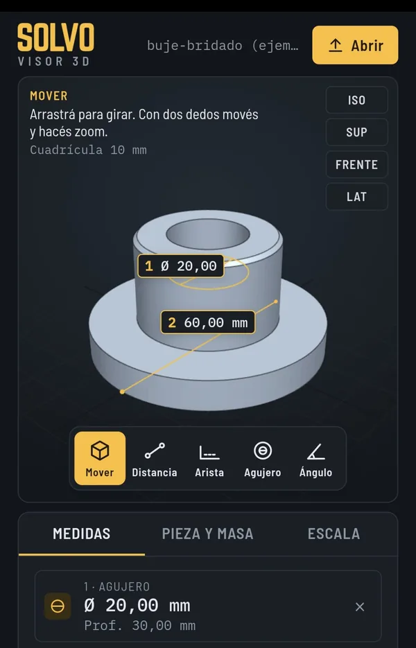

# SOLVO Visor 3D

Visor gratuito para abrir y medir archivos 3D: en el navegador o como app para Android.

- **Usalo en el navegador:** https://solvo-herramientas.github.io/visor-3d/
- **App para Android e instrucciones:** https://solvo.ar/visor-3d/

## Qué hace

- Abre archivos **STL, 3MF, OBJ y STEP**.
- Mide distancias, aristas, diámetro y profundidad de agujeros, y ángulos.
- Vistas isométrica, superior, frontal y lateral.
- Estima la masa de la pieza impresa en PLA, PETG, ABS, nylon y TPU, según paredes y relleno, y el costo de material a partir del $/kg.
- Escala la pieza a partir de una medida.
- Botón para pedir cotización a SOLVO.

Los archivos se procesan en el dispositivo: no se suben a ningún servidor.

La versión web se puede instalar desde el navegador («Instalar como app» en Chrome o Edge, «Agregar a inicio» en iPhone) y funciona sin conexión.

## Descargas para Android

Las versiones están en [Releases](../../releases). El enlace a la última versión es siempre el mismo:

https://github.com/solvo-herramientas/visor-3d/releases/latest/download/SOLVO-Visor3D.apk

## Autor

Desarrollado por [SOLVO Fabricaciones Digitales](https://solvo.ar), San Juan, Argentina.
¿Necesitás fabricar una pieza? Escribinos por [WhatsApp](https://wa.me/5492645484363) o a contacto@solvo.ar.
